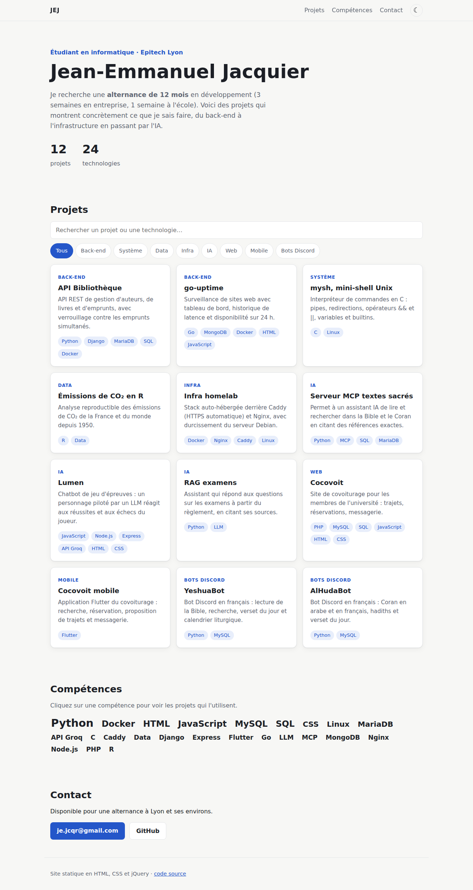

# Portfolio — Jean-Emmanuel Jacquier

[](https://github.com/jejcqr/portfolio-web/actions/workflows/ci.yml)

Mon site portfolio : une page qui présente tous mes projets GitHub, avec
recherche, filtres par catégorie et par compétence, fiche détaillée de chaque
projet et thème sombre. Site statique en **HTML**, **CSS** et **jQuery**,
déployé automatiquement sur GitHub Pages.



## Compétences démontrées

| Compétence | Où la voir |
|---|---|
| HTML sémantique et accessible | `header`/`main`/`section`, modale `role="dialog"` avec piège à focus et arrière-plan `inert`, cartes utilisables au clavier, `aria-pressed` — `index.html`, `js/app.js` |
| CSS moderne | variables, thème clair/sombre (préférence système + choix mémorisé), grille responsive, `color-mix`, défilement doux (`scroll-behavior`), `prefers-reduced-motion` — `css/style.css` |
| jQuery | chargement AJAX (`$.getJSON`), délégation d'événements, animations et compteurs animés, coupés par `prefers-reduced-motion` — `js/app.js` |
| JavaScript | logique de filtrage séparée du DOM, recherche insensible aux accents — `js/filtres.js` |
| Tests | tests unitaires `node --test` et tests Playwright sur ordinateur et mobile |
| Qualité | ESLint (règles recommandées, `const`/`let` imposés) et Prettier — `eslint.config.js`, `.prettierrc.json` |
| CI/CD | GitHub Actions : lint et tests, puis déploiement sur GitHub Pages ; permissions minimales par job |

## Pourquoi jQuery

jQuery figure sur mon CV : ce projet montre que je sais m'en servir proprement
(délégation d'événements, AJAX, animations qui respectent `prefers-reduced-motion`).
Pour un nouveau site, je choisirais du JavaScript natif ou un framework. La logique
qui compte, le filtrage, est d'ailleurs écrite sans jQuery ni DOM (`js/filtres.js`)
et testée seule.

## Fonctionnement

Les projets sont décrits dans [`data/projets.json`](data/projets.json) : ajouter
un projet ne demande aucune modification du code. Le nuage de compétences et
les compteurs sont calculés à partir de ce fichier.

```json
{
  "id": "go-uptime",
  "titre": "go-uptime",
  "resume": "Surveillance de sites web avec tableau de bord…",
  "details": "Une goroutine par site surveillé…",
  "competences": ["Go", "MongoDB", "Docker"],
  "categorie": "back-end",
  "depot": "https://github.com/jejcqr/go-uptime"
}
```

## Lancer en local

```bash
npm start      # lance python3 -m http.server 8080 --bind 127.0.0.1
# puis ouvrir http://127.0.0.1:8080
```

`npm start` ne télécharge rien : il lance le serveur intégré à Python 3, le même
que celui que démarrent les tests Playwright.

## Documentation

[`docs/EXPLICATIONS.md`](docs/EXPLICATIONS.md) ([PDF](docs/EXPLICATIONS.pdf)) explique l'architecture, comment refaire le projet étape par étape et les mauvaises pratiques à éviter. Le PDF est régénéré automatiquement par la CI à chaque modification du Markdown.

## Tests

```bash
npm install
npm run lint                      # ESLint
npm run format:check              # Prettier (npm run format pour corriger)
npm test                          # filtres et validité de projets.json
npx playwright install chromium
npm run test:e2e                  # recherche, filtres, modale, clavier, thème, mobile
```

`npm run test:e2e` lance son propre serveur sur le port 8080 : arrêter `npm start` avant.

## Mise en ligne

Rendre le dépôt public, puis activer GitHub Pages dans *Settings → Pages → Source : GitHub Actions*.
Chaque push sur `main` relance les tests puis publie le site ; tant que le dépôt est privé,
le job de déploiement est sauté.
